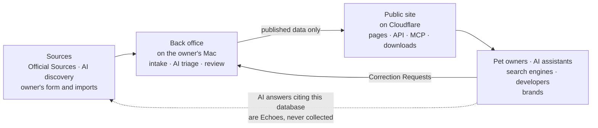
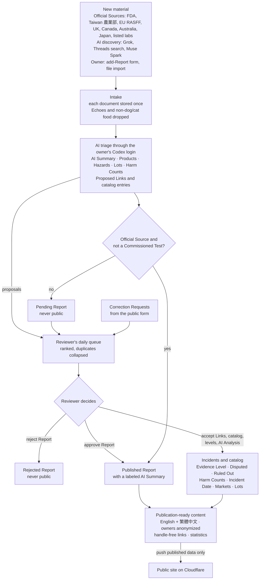
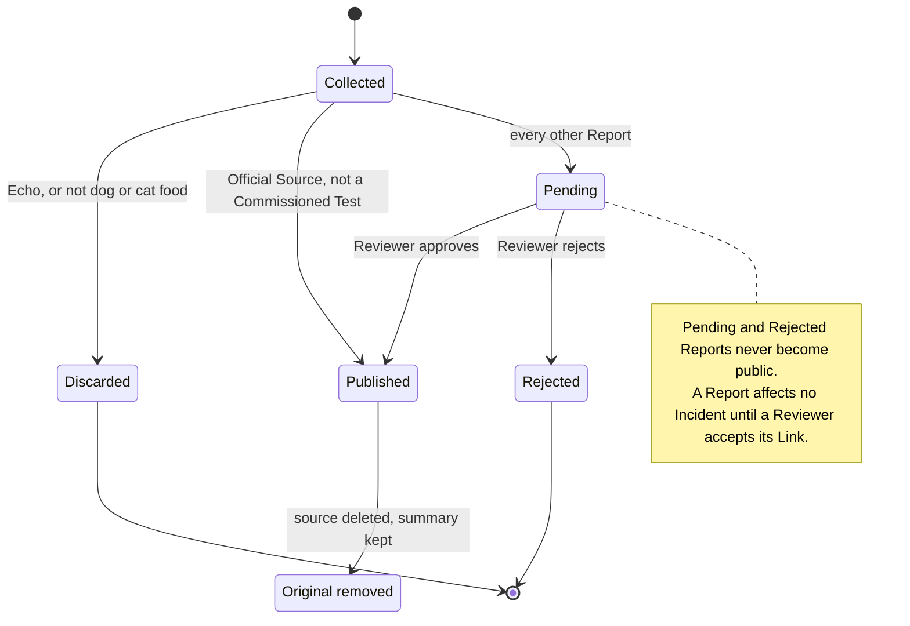
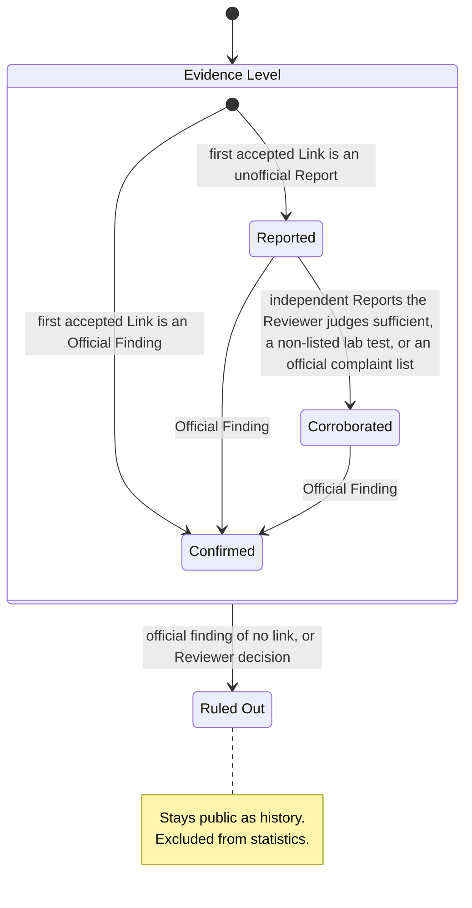
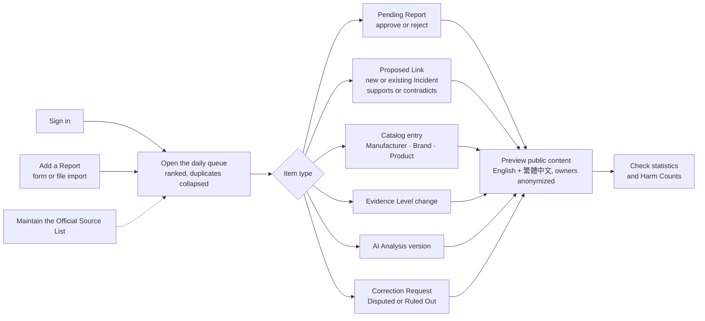
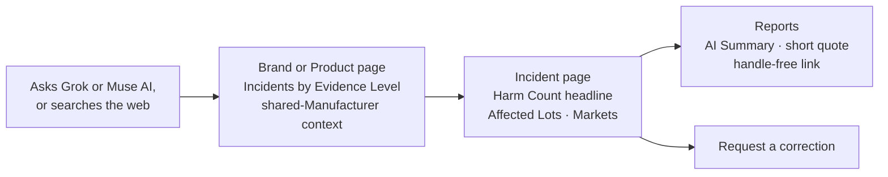
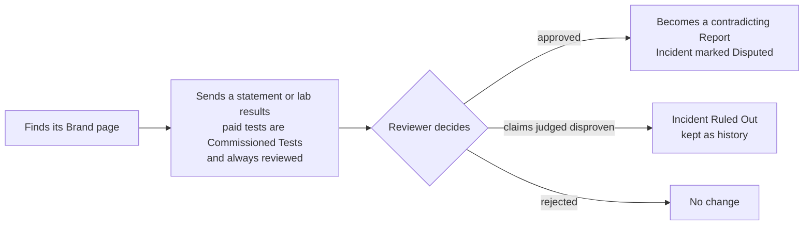
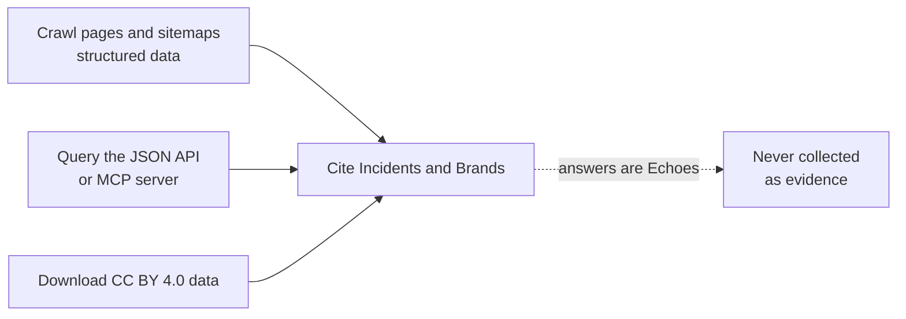

# System flow and user feature map

How a pet food safety Report moves from its source to the public, and what each kind of user can do. Terms in capitals are defined in [CONTEXT.md](../CONTEXT.md). The architecture is in [ADR 0001](adr/0001-mac-back-office-cloud-public-site.md), and the stage 1 work is tracked in [issue #1](https://github.com/0xroylee/pets-foods-database/issues/1).

Build stages used below: **1** core data model and review page · **2** FDA collector · **3** public pages · **4** Grok discovery · **5** JSON API, MCP server and downloads · **6** other regulators and Lab Test sources · **7** Threads and Muse Spark · **8** AI Analysis generation.

## 1. How the system works

Everything private stays in the back office on the owner's Mac. Only published data is pushed to the read-only public site.

### Inside the back office

### Report lifecycle

### Incident Evidence Level

Every level change needs the Reviewer's approval. **Disputed** is a mark shown beside any level once a Published Report with an approved contradicting Link exists.

Levels are reassessed when supporting evidence is withdrawn, for example when a Report later turns out to be an Echo.

## 2. User flows

### Owner as Reviewer (stage 1)

### Pet owner (stage 3)

### Brand or Manufacturer (stage 3, reviewed with stage 1 rules)

### AI assistants, search engines and developers (stages 3 and 5)

## 3. Feature map

Each feature with its build stage and, for stage 1, the GitHub issue that builds it.

### Owner as Reviewer

| Activity | Feature | Stage | Issue |
| --- | --- | --- | --- |
| Get in | Reviewer accounts, password sign-in, more Reviewers later | 1 | [#2](https://github.com/0xroylee/pets-foods-database/issues/2) |
| Foundation | Data model, each Report stored once, dog and cat food only | 1 | [#3](https://github.com/0xroylee/pets-foods-database/issues/3) |
| Feed the system | Add a Report by form, such as a vet report someone sends you | 1 | [#14](https://github.com/0xroylee/pets-foods-database/issues/14) |
| Feed the system | Import records in the format collectors will use | 1 | [#14](https://github.com/0xroylee/pets-foods-database/issues/14) |
| Feed the system | FDA collector with full backfill | 2 | |
| Feed the system | Grok discovery of X posts and web news, spend recorded, $50/month cap | 4 | |
| Feed the system | Taiwan 農業部, EU RASFF, UK, Canada, Australia, Japan and Lab Test sources | 6 | |
| Feed the system | Threads keyword search and Muse Spark web search | 7 | |
| Triage | Private AI processing through your Codex login | 1 | [#4](https://github.com/0xroylee/pets-foods-database/issues/4) |
| Triage | AI Summaries and proposals, duplicates collapsed, ranked daily queue | 1 | [#12](https://github.com/0xroylee/pets-foods-database/issues/12) |
| Decide | Official Source List, publication gates, Commissioned Tests | 1 | [#5](https://github.com/0xroylee/pets-foods-database/issues/5) |
| Decide | Proposed Links: new or existing Incident, Stance | 1 | [#6](https://github.com/0xroylee/pets-foods-database/issues/6) |
| Decide | Evidence Levels and Echo exclusion | 1 | [#7](https://github.com/0xroylee/pets-foods-database/issues/7) |
| Decide | Correction Requests, Disputed and Ruled Out | 1 | [#8](https://github.com/0xroylee/pets-foods-database/issues/8) |
| Decide | Catalog of Manufacturers, Brands and Products; shared-Manufacturer context | 1 | [#13](https://github.com/0xroylee/pets-foods-database/issues/13) |
| Decide | Markets and Affected Lots | 1 | [#15](https://github.com/0xroylee/pets-foods-database/issues/15) |
| Check | Harm Counts with conservative animal de-duplication | 1 | [#10](https://github.com/0xroylee/pets-foods-database/issues/10) |
| Check | Incident Date and statistics | 1 | [#11](https://github.com/0xroylee/pets-foods-database/issues/11) |
| Publish | English and 繁體中文 content, owner anonymity, handle-free links, AI Analysis versions | 1 | [#9](https://github.com/0xroylee/pets-foods-database/issues/9) |
| Publish | Push published data to the Cloudflare site | 3 | |
| Publish | AI Analysis generation | 8 | |
| Verify | End-to-end check of every approval and attribution rule | 1 | [#16](https://github.com/0xroylee/pets-foods-database/issues/16) |

### Pet owner

| Activity | Feature | Stage |
| --- | --- | --- |
| Find | Arrive from an AI assistant answer or a web search | 3 |
| Look up | Brand, Product and Manufacturer pages with Incidents by Evidence Level | 3 |
| Look up | Incident page with the Harm Count headline, Affected Lots, Markets, and Disputed or Ruled Out marks | 3 |
| Read | Each Report's AI Summary, a short quote and a handle-free link | 3 |
| Read | Statistics by Brand, Manufacturer, Hazard, Market and year | 3 |
| Read | English and 繁體中文 | 3 |
| Act | Request a correction | 3 |
| Not in v1 | Accounts and alerts | |

### Brand or Manufacturer

| Activity | Feature | Stage | Issue |
| --- | --- | --- | --- |
| Respond | Request a correction or send a statement through the public form | 3 | |
| Outcome | An approved statement becomes a contradicting Report and marks the Incident Disputed | 1 | [#8](https://github.com/0xroylee/pets-foods-database/issues/8) |
| Outcome | A paid lab test is a Commissioned Test and always waits for review | 1 | [#5](https://github.com/0xroylee/pets-foods-database/issues/5) |
| Fairness | Shared-Manufacturer Incidents show as context but don't count against an unaffected Brand | 1 | [#13](https://github.com/0xroylee/pets-foods-database/issues/13) |

### AI assistants, search engines and developers

| Activity | Feature | Stage | Issue |
| --- | --- | --- | --- |
| Crawl | Pages with structured data and sitemaps, AI crawlers allowed | 3 | |
| Query | JSON API and MCP server | 5 | |
| Download | CC BY 4.0 data downloads | 5 | |
| Guard | Answers that cite this database are Echoes and never count as evidence | 1 | [#7](https://github.com/0xroylee/pets-foods-database/issues/7) |
